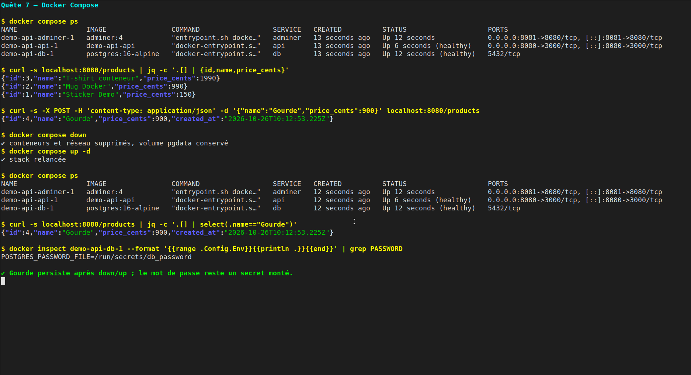

# Quête 7 — Docker : Docker Compose

## Travail réalisé

J’ai écrit `compose.yml` pour lancer les trois services du fil rouge : `api` construit depuis `./api`, `db` sur `postgres:16-alpine` et `adminer` sur `adminer:4`. La base n’est pas publiée sur l’hôte ; l’API est publiée sur `${API_PORT:-8080}` et Adminer sur `${ADMINER_PORT:-8081}`. `db` utilise le volume nommé `pgdata`, monte `db/init.sql` en lecture seule et expose un healthcheck `pg_isready`. `api` attend que `db` soit `service_healthy` avant de démarrer, puis redémarre avec `restart: unless-stopped`.

J’ai centralisé la configuration dans `.env`, avec un `.env.example` commité et `.env` ignoré. Le mot de passe de la base passe par un secret Docker monté dans `/run/secrets/db_password` : PostgreSQL le lit avec `POSTGRES_PASSWORD_FILE` et l’API avec `PGPASSWORD_FILE`. J’ai adapté `api/db.js` pour lire ce fichier quand la variable est définie. `secrets/db_password.txt` est ignoré ; seul `secrets/db_password.txt.example` est versionné. `COMPOSE_PROJECT_NAME=demo-api` garde des noms de conteneurs lisibles et conformes au cours.

`.env` sert uniquement à l’interpolation `${}` de Compose. Il n’est pas injecté tel quel dans les conteneurs : les variables utiles sont déclarées dans `environment:`, et le mot de passe arrive par le secret.

## Prérequis et démarrage

Docker avec le plugin Compose v2, et les ports 8080 et 8081 libres.

```bash
cp .env.example .env
cp secrets/db_password.txt.example secrets/db_password.txt
# remplacer « change-moi » par le mot de passe voulu dans secrets/db_password.txt
docker compose up -d --build
```

URLs :

- API : <http://localhost:8080/products>
- Santé : <http://localhost:8080/health> et <http://localhost:8080/ready>
- Adminer : <http://localhost:8081> (serveur `db`, utilisateur `demo`, base `demo`)

## Commandes et vérifications

J’ai lancé la stack depuis la racine du dépôt :

```bash
docker compose up -d --build
```

Extrait observé :

```text
Container demo-api-db-1 Healthy
Container demo-api-api-1 Started
Container demo-api-adminer-1 Started
```

`docker compose config --quiet` s’est terminé avec le code 0. La configuration résolue contient `POSTGRES_PASSWORD_FILE=/run/secrets/db_password` et aucun mot de passe en clair.

État des services :

```bash
docker compose ps
```

```text
NAME                 IMAGE                COMMAND                  SERVICE   CREATED          STATUS                    PORTS
demo-api-adminer-1   adminer:4            "entrypoint.sh docke…"   adminer   41 seconds ago   Up 40 seconds             0.0.0.0:8081->8080/tcp, [::]:8081->8080/tcp
demo-api-api-1       demo-api-api         "docker-entrypoint.s…"   api       41 seconds ago   Up 35 seconds (healthy)   0.0.0.0:8080->3000/tcp, [::]:8080->3000/tcp
demo-api-db-1        postgres:16-alpine   "docker-entrypoint.s…"   db        41 seconds ago   Up 40 seconds (healthy)   5432/tcp
```

La base est `healthy`, l’API est `Up (healthy)` et `db` ne publie que le port interne `5432/tcp`. Adminer répond en HTTP 200 sur `localhost:8081`.

Les produits de `db/init.sql` sont bien présents :

```bash
curl -s localhost:8080/products | jq -c '.[] | {id,name,price_cents}'
```

```text
{"id":3,"name":"T-shirt conteneur","price_cents":1990}
{"id":2,"name":"Mug Docker","price_cents":990}
{"id":1,"name":"Sticker Demo","price_cents":150}
```

La commande brute `curl -s localhost:8080/products` renvoie les mêmes produits avec le champ `created_at` en plus.

J’ai ajouté « Gourde » :

```bash
curl -s -X POST -H 'content-type: application/json' \
  -d '{"name":"Gourde","price_cents":900}' localhost:8080/products
```

```text
{"id":4,"name":"Gourde","price_cents":900,"created_at":"2026-10-26T10:12:53.225Z"}
```

Après `docker compose down` puis `docker compose up -d`, la Gourde est toujours là :

```bash
curl -s localhost:8080/products | jq -c '.[] | select(.name=="Gourde")'
```

```text
{"id":4,"name":"Gourde","price_cents":900,"created_at":"2026-10-26T10:12:53.225Z"}
```

`down` supprime les conteneurs et le réseau mais conserve le volume nommé `pgdata`. Le secret n’apparaît pas en clair dans la configuration du conteneur :

```bash
docker inspect demo-api-db-1 --format '{{range .Config.Env}}{{println .}}{{end}}' | grep PASSWORD
```

```text
POSTGRES_PASSWORD_FILE=/run/secrets/db_password
```

Le fichier `/run/secrets/db_password` est monté dans `db` et dans `api`.

## Repartir de zéro

```bash
docker compose down -v
docker compose up -d --build
```

`down -v` supprime aussi le volume `pgdata` : `db/init.sql` est rejoué au démarrage suivant et les trois produits initiaux reviennent.

## Capture d’écran



## Liens de publication

- Dépôt GitHub : [ynov-x-anthony/GARRIGUES_hugo_demo-api](https://github.com/ynov-x-anthony/GARRIGUES_hugo_demo-api)
- Branche de rendu `quest/docker-7-docker-compose` : à pousser après vérification.
