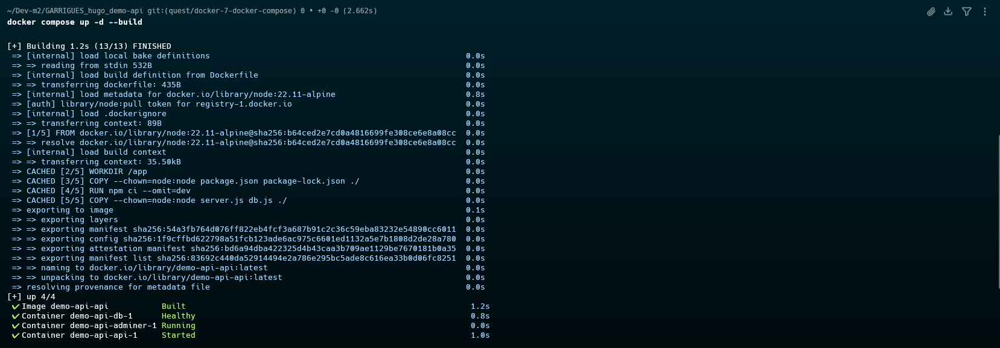
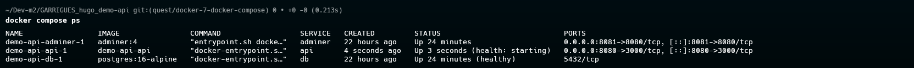
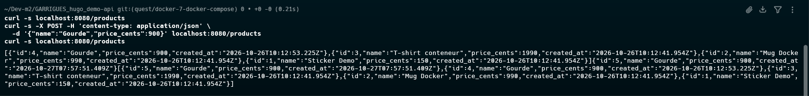
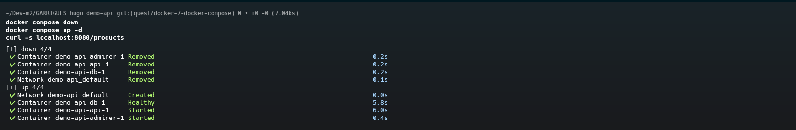
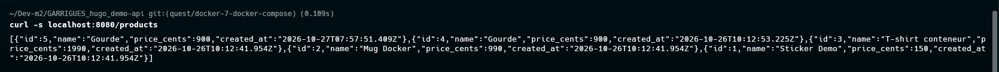
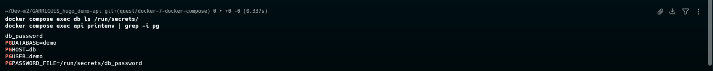
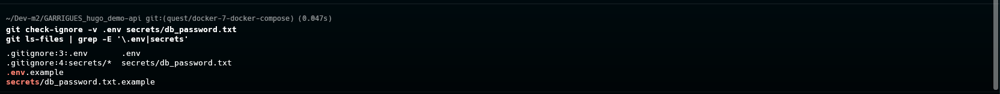

# Quête 7 — Docker : Docker Compose

## Travail réalisé

`compose.yml` lance les trois services du fil rouge :

- `api` : construit depuis `./api`, publiée sur `${API_PORT:-8080}`.
- `db` : `postgres:16-alpine`, non publiée sur l’hôte, avec le volume nommé `pgdata`, `db/init.sql` monté en lecture seule et un healthcheck `pg_isready`.
- `adminer` : `adminer:4`, publiée sur `${ADMINER_PORT:-8081}`.

`api` attend que `db` soit `service_healthy` avant de démarrer et redémarre avec `restart: unless-stopped`.

La configuration passe par `.env` (interpolation `${}` de Compose, avec `.env.example` versionné et `.env` ignoré). Le mot de passe de la base est un secret Docker monté dans `/run/secrets/db_password` : PostgreSQL le lit via `POSTGRES_PASSWORD_FILE`, l’API via `PGPASSWORD_FILE`. `api/db.js` lit ce fichier lorsque la variable est définie. `secrets/db_password.txt` est ignoré par Git, seul `secrets/db_password.txt.example` est versionné.

`.env` ne sert qu’à l’interpolation : il n’est pas injecté dans les conteneurs. Les variables utiles sont déclarées dans `environment:`, et le mot de passe arrive par le secret.

## Prérequis et démarrage

- Docker avec le plugin Compose v2.
- Les ports 8080 et 8081 libres.

```bash
cp .env.example .env
cp secrets/db_password.txt.example secrets/db_password.txt
# remplacer « change-moi » par le mot de passe voulu dans secrets/db_password.txt
docker compose up -d --build
```

URLs :

- API : <http://localhost:8080/products>
- Santé : <http://localhost:8080/health> et <http://localhost:8080/ready>
- Adminer : <http://localhost:8081> (serveur `db`, utilisateur `demo`, base `demo`)

## Vérifications

### Démarrage de la stack

```text
Container demo-api-db-1 Healthy
Container demo-api-api-1 Started
Container demo-api-adminer-1 Started
```



`docker compose config --quiet` se termine avec le code 0. La configuration résolue contient `POSTGRES_PASSWORD_FILE=/run/secrets/db_password` et aucun mot de passe en clair.

### État des services

```text
NAME                 IMAGE                COMMAND                  SERVICE   CREATED          STATUS                    PORTS
demo-api-adminer-1   adminer:4            "entrypoint.sh docke…"   adminer   41 seconds ago   Up 40 seconds             0.0.0.0:8081->8080/tcp, [::]:8081->8080/tcp
demo-api-api-1       demo-api-api         "docker-entrypoint.s…"   api       41 seconds ago   Up 35 seconds (healthy)   0.0.0.0:8080->3000/tcp, [::]:8080->3000/tcp
demo-api-db-1        postgres:16-alpine   "docker-entrypoint.s…"   db        41 seconds ago   Up 40 seconds (healthy)   5432/tcp
```



La base est `healthy`, l’API est `Up (healthy)` et `db` ne publie que le port interne `5432/tcp`. Adminer répond en HTTP 200 sur `localhost:8081`.

### API et persistance

Les produits de `db/init.sql` sont présents :

```text
{"id":3,"name":"T-shirt conteneur","price_cents":1990}
{"id":2,"name":"Mug Docker","price_cents":990}
{"id":1,"name":"Sticker Demo","price_cents":150}
```

`curl -s localhost:8080/products` renvoie les mêmes produits avec le champ `created_at` en plus.



Ajout du produit « Gourde » :

```text
{"id":4,"name":"Gourde","price_cents":900,"created_at":"2026-10-26T10:12:53.225Z"}
```

Après `docker compose down` puis `docker compose up -d`, « Gourde » est toujours présente :

```text
{"id":4,"name":"Gourde","price_cents":900,"created_at":"2026-10-26T10:12:53.225Z"}
```





`down` supprime les conteneurs et le réseau mais conserve le volume nommé `pgdata`.

### Secrets

Le secret n’apparaît pas en clair dans la configuration du conteneur :

```text
POSTGRES_PASSWORD_FILE=/run/secrets/db_password
```

Le fichier `/run/secrets/db_password` est monté dans `db` et dans `api`.



### Fichiers sensibles et Git

`.env` et `secrets/db_password.txt` sont ignorés, `.env.example` et `secrets/db_password.txt.example` sont suivis.



## Repartir de zéro

```bash
docker compose down -v
docker compose up -d --build
```

`down -v` supprime aussi le volume `pgdata` : `db/init.sql` est rejoué au démarrage suivant et les trois produits initiaux reviennent.

## Liens de publication

- Dépôt GitHub : [ynov-x-anthony/GARRIGUES_hugo_demo-api](https://github.com/ynov-x-anthony/GARRIGUES_hugo_demo-api)
- Branche de rendu : [`quest/docker-7-docker-compose`](https://github.com/ynov-x-anthony/GARRIGUES_hugo_demo-api/tree/quest/docker-7-docker-compose)
