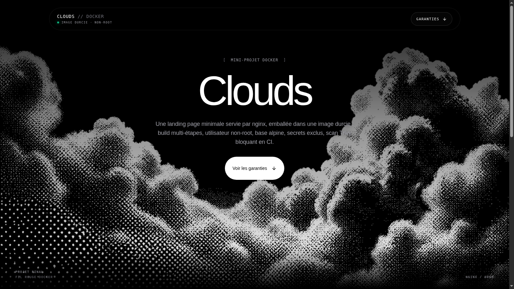
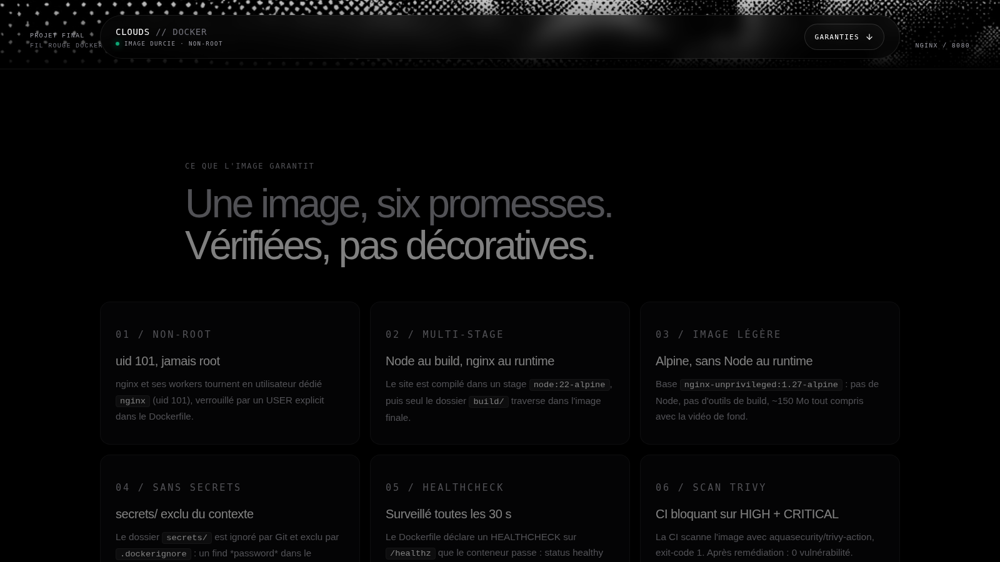

# Projet final — Landing page clouds, conteneurisée

Projet de fin de fil rouge : une mini landing page qui sert de support pour
remettre en pratique tout ce qu'on a vu ensemble en Docker — sécurité,
build multi-stage, scan Trivy et petite CI/CD. Le contenu est volontairement
très simple (une page : hero vidéo de nuages + section « Ce que l'image
garantit »), et le langage visuel est repris du portfolio personnel « HGRS » :
noir & blanc dithering, typo mono,
nav pill floue, cartes fines à bordures 1px. Toute la difficulté est sur
l'emballage Docker, jamais sur le code.

## Travail réalisé

L'objectif était de partir d'un asset visuel (une vidéo de nuages en
dithering et un poster PNG) et d'en faire un vrai projet conteneurisé avec
toutes les bonnes pratiques du fil rouge. Je suis parti sur une page
statique plutôt que sur l'API Express du fil rouge : c'est un support
différent, plus lisible, et il permet de montrer le multi-stage avec un
runtime autre que Node.

Fichiers créés ou modifiés :

| Fichier | Rôle |
|---|---|
| `landing/site/index.html` | la page : hero vidéo (support : poster + `<video>`), section des 6 garanties de l'image, footer avec le numéro de build injecté |
| `landing/site/style.css` | la feuille de style : langage visuel inspiré du portfolio HGRS (noir, typo mono, nav pill backdrop-blur, cartes `#09090b` à bordures fines), ~400 lignes sans framework |
| `assets/clouds-dither.mp4`, `assets/clouds-dither.png` | l'asset visuel : vidéo de nuages en dithering + poster, en fond du hero |
| `landing/build.mjs` | script de build sans dépendance npm : minification HTML simple + injection du numéro de build, sortie dans `build/` |
| `landing/Dockerfile` | build multi-stage : stage `build` (node:22-alpine) puis stage runtime (nginxinc/nginx-unprivileged:1.27-alpine) |
| `landing/nginx.conf` | serveur sur le port 8080, `server_tokens off`, gzip, route `/healthz` pour le HEALTHCHECK, cache sur `/assets/` |
| `.dockerignore` | exclut `secrets/`, `api/`, `db/`, `.git`, `node_modules`… du contexte de build |
| `.gitignore` | ajout de `secrets/` pour qu'aucun secret ne se retrouve suivi par Git |
| `.github/workflows/landing-ci.yml` | CI/CD : build de l'image, scan Trivy bloquant, publication sur GHCR sur `main` |

Problème rencontré et corrigé en design : la vidéo était bien servie
(codec `avc1`, octets identiques à l'original) mais invisible à l'écran.
Cause : le fond opaque était posé sur `html` **et** `body` en CSS, et la
couche de fond du `body` peint au-dessus des éléments en `z-index`
négatif — la vidéo partait donc sous une sorte de fond noir uni. Le fond
vit désormais sur `html` seul et `body` est transparent. Un voile sombre
qui masquait les nuages a aussi été retiré.

Les bonnes pratiques couvertes :

- **Utilisateur non-root** : l'image de base `nginxinc/nginx-unprivileged`
  démarre en uid 101, c'est verrouillé par un `USER 101` explicite.
  `docker exec landing-test id` renvoie `uid=101(nginx)`.
- **Image légère** : pas de Node au runtime, base alpine seulement.
  Image finale : ~150 Mo (dont ~27 Mo d'assets vidéo/affiche transférés).
- **Pas de secrets** : le dossier `secrets/` (et `db_password.txt` de la
  quête build multi-étapes) est exclu du contexte par `.dockerignore` et
  ignoré par Git. Une recherche de `*password*` dans le système de
  fichiers de l'image ne renvoie rien.
- **HEALTHCHECK** sur `http://127.0.0.1:8080/healthz`, toutes les 30 s.
- **Secrets de CI** : seul `GITHUB_TOKEN` fourni par GitHub Actions est
  utilisé pour la publication sur GHCR ; rien n'est écrit en dur.
- **Versions de base images figées** (`node:22-alpine`,
  `nginxinc/nginx-unprivileged:1.27-alpine`).

## Commandes et vérifications

### Build multi-stage

Attendu : l'image se construit depuis la racine du repo (contexte), le
stage `build` prépare le site compilé et le runtime ne reçoit que le
contenu servi.

Commande exécutée :

```bash
docker build -f landing/Dockerfile --build-arg LAND_VERSION=1.0.0 \
  -t landing-clouds:1.0.0 .
```

Constaté : le build passe les deux étages :

```
#8  [build 1/6] FROM docker.io/library/node:22-alpine
#9  [stage-1 1/3] FROM docker.io/nginxinc/nginx-unprivileged:1.27-alpine
#14 [build 6/6] RUN node build.mjs
```

Taille constatée :

```
$ docker images landing-clouds:1.0.0 --format '{{.Size}}'
150MB
```

### Démarrage et vérifications d'exécution

Attendu : la page répond, la vidéo est servie, le conteneur est healthy et
tourne en non-root. Le port hôte 8080 étant déjà pris par la stack
`demo-api-compose` de la quête Compose (que je n'ai pas touchée), je
publie la landing sur le port hôte 8090.

```bash
docker run -d --name landing-test -p 8090:8080 landing-clouds:1.0.0
```

Constaté :

```
$ docker inspect --format '{{.State.Health.Status}}' landing-test
healthy

$ curl -s http://127.0.0.1:8090/healthz
ok

$ docker exec landing-test id
uid=101(nginx) gid=101(nginx) groups=101(nginx)

$ curl -sI http://127.0.0.1:8090/assets/clouds-dither.mp4 | head -3
HTTP/1.1 200 OK
Server: nginx          ← pas de version de nginx : server_tokens off fonctionne
Content-Type: video/mp4

$ curl -s http://127.0.0.1:8090/ | grep -o 'Build <span class="muted-light">[^<]*'
Build <span class="muted-light">1.0.0   ← le numéro de build a bien été injecté au build
```

### Absence de secrets dans l'image

```
$ docker exec landing-test sh -c 'find / -xdev -name "*password*" 2>/dev/null'
(aucun résultat)

$ docker exec landing-test find /usr/share/nginx/html -maxdepth 1
/usr/share/nginx/html
/usr/share/nginx/html/index.html
/usr/share/nginx/html/style.css     ← uniquement le contenu compilé,
/usr/share/nginx/html/assets         pas de sources, pas de secrets
```

## Preuve spécifique : scan Trivy

Trivy n'était pas installé en CLI sur ma machine, je l'ai donc exécuté de
la même façon que la CI : via l'image officielle `aquasec/trivy`, montée
sur le socket Docker local.

### Premier scan : des failles détectées, la CI aurait bloqué

```
$ docker run --rm -v /var/run/docker.sock:/var/run/docker.sock \
    aquasec/trivy:latest image \
    --severity CRITICAL,HIGH --ignore-unfixed landing-clouds:1.0.0

Report Summary
Total: 58 (HIGH: 56, CRITICAL: 2)
(pcre2, tiff, zlib… des paquets alpine de l'image de base, avec
correctifs disponibles)
```

Avec `exit-code: 1` (comme dans le job CI), ce scan aurait fait échouer
le pipeline. C'était un bon cas réel de remédiation.

### Remédiation

J'ai ajouté dans le stage runtime du `Dockerfile` : passage temporaire en
root, `apk update && apk upgrade --no-cache`, retour en uid 101. Puis
rebuild et nouvelle vérification d'exécution (`healthy`, `healthz` ok).

### Deuxième scan : image saine

```
$ docker run --rm -v /var/run/docker.sock:/var/run/docker.sock \
    aquasec/trivy:latest image \
    --severity CRITICAL,HIGH --ignore-unfixed landing-clouds:1.0.0

│                Target                │  Type  │ Vulnerabilities │ Secrets │
│ landing-clouds:1.0.0 (alpine 3.21.3) │ alpine │        0        │    -    │
│                                       │        │  0 = Clean      │         │
```

## CI/CD

`.github/workflows/landing-ci.yml` (déclenché sur push vers `main` et vers
la branche du projet, sur les PR touchant `landing/` ou `assets/`, et
manuellement via `workflow_dispatch`) :

1. **build** de l'image avec `docker build-push-action` (buildx, `load: true`).
2. **scan Trivy** avec `aquasecurity/trivy-action` : sévérités
   CRITICAL + HIGH, `exit-code: 1`, `ignore-unfixed: true` → le pipeline
   échoue si l'image n'est pas saine.
3. **publication** : sur `main` seulement, l'image est poussée sur GHCR
   (`ghcr.io/<repo>/landing-clouds:sha` + `latest`), authentifiée avec le
   `GITHUB_TOKEN` (permissions `packages: write`).

Le scan local ci-dessus reproduit exactement les étapes 1 et 2 de la CI.

## Captures d'écran

Captures Chrome headless sur les pages servies par le conteneur :

-  : le hero,
  avec la vidéo en dithering, la nav pill et le bouton du hero.
-  : les six
  garanties de l'image, dans le langage visuel du design repris.

## Liens de publication

- Repo GitHub : [ynov-x-anthony/GARRIGUES_hugo_demo-api](https://github.com/ynov-x-anthony/GARRIGUES_hugo_demo-api)
- Branche du projet : [`projet/docker-final`](https://github.com/ynov-x-anthony/GARRIGUES_hugo_demo-api/tree/projet/docker-final)
- Run CI `landing-docker` (build + scan Trivy) :
  [run 40507896466](https://github.com/ynov-x-anthony/GARRIGUES_hugo_demo-api/actions/runs/40507896466) —
  terminé avec succès en 46 s.
- Image GHCR : `ghcr.io/ynov-x-anthony/garrigues_hugo_demo-api/landing-clouds`
  (tags `sha` + `latest`) — le job `publish` la pousse automatiquement
  après la fusion de la branche sur `main`.
