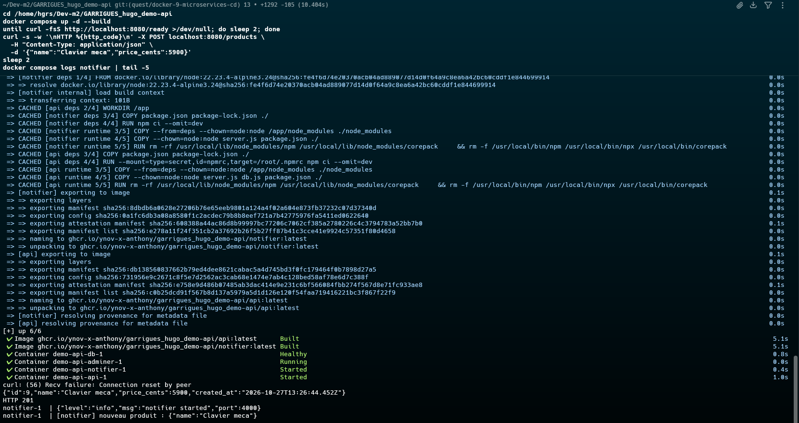
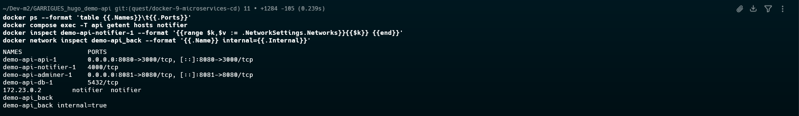

# Quête 9 : Docker, microservices et déploiement continu

## Travail réalisé

J’ai fait passer la stack d’une application multi-conteneurs à une vraie séparation en deux services métier. `notifier` est maintenant un service indépendant, avec son propre `package.json`, son propre `Dockerfile` et son propre cycle de build/publication. `api` ne connaît de lui qu’une URL interne : `http://notifier:4000/notify`.

La différence concrète avec la stack précédente, c’est que `notifier` peut être reconstruit et publié sans toucher à l’image de `api`. Les deux services ne partagent ni code, ni build, seulement le réseau `back` et un contrat HTTP très simple.

Fichiers créés ou modifiés :

| Fichier | Rôle |
|---|---|
| `notifier/server.js` | service Express minimal : `GET /health` et `POST /notify`, qui logge le corps reçu |
| `notifier/package.json` + `notifier/package-lock.json` | dépendances propres au service (`express` 4.22.3, audit à 0 vulnérabilité) |
| `notifier/Dockerfile` | build multi-stage durci : base `node:22.23.4-alpine3.24`, `USER node`, `HEALTHCHECK`, `npm`/`corepack` retirés du runtime |
| `notifier/.dockerignore` | contexte de build minimal |
| `compose.yml` | ajout du service `notifier`, réseaux `front`/`back`, images GHCR paramétrées |
| `api/server.js` | appel HTTP best-effort vers `notifier` après un `POST /products` réussi |
| `.github/workflows/ci.yml` | CI en matrix `api`/`notifier`, gate Trivy et publication GHCR, puis job `deploy` sur les tags `v*` |
| `.env.example` | ajout de `NOTIFIER_PORT`, `IMAGE_PREFIX` et `IMAGE_TAG` |

### Séparation réseau

J’ai ajouté les deux réseaux demandés :

- `front` : réseau des services exposés (ceux qui publient un port), utilisé par `api` et `adminer` ;
- `back` : réseau interne (`internal: true`), utilisé par `api`, `db`, `notifier` et `adminer` (Adminer doit joindre la base).

`notifier` n’est que sur `back` et n’a **aucun `ports:`**. Comme `db`, il n’est joignable que par les autres conteneurs du réseau. C’est le DNS interne de Compose qui résout `notifier` et `db` par leur nom de service.

### Appel best-effort

Après l’insertion en base, `api` renvoie immédiatement le `201` avec le produit créé, puis lance l’appel vers `notifier` sans l’attendre. L’appel a un timeout de 2 s et toutes ses erreurs sont seulement loggées : une panne de `notifier` ne peut donc pas faire échouer la création d’un produit.

### Images et déploiement

Les deux services ont maintenant une image explicite dans Compose :

```text
${IMAGE_PREFIX}/api:${IMAGE_TAG}
${IMAGE_PREFIX}/notifier:${IMAGE_TAG}
```

En local, `IMAGE_TAG` vaut `latest` et le build se fait avec `docker compose up --build`. En déploiement, le job passe `IMAGE_TAG` à la version du tag Git (`v1.5.0` par exemple) : `docker compose pull` récupère exactement les images publiées et scannées en CI, sans rebuild sur la cible.

### CI/CD

Le job `image` utilise une matrix :

- `api` → `api/Dockerfile.multi` ;
- `notifier` → `notifier/Dockerfile`.

Chaque service est construit séparément, scanné par Trivy (`CRITICAL,HIGH`, `ignore-unfixed`, `exit-code: 1`) puis poussé sur GHCR sous `ghcr.io/<repo>/<service>:<tag>` uniquement sur un tag `v*`. Le nom du dépôt est passé en minuscules, GHCR refusant les majuscules.

Le job `deploy` dépend du job `image` et ne s’exécute que sur les tags `v*`. Il se connecte à GHCR, prépare un `.env` et un secret de base éphémères, puis exécute la même mécanique qu’un serveur :

```bash
docker compose pull
docker compose up -d --remove-orphans
```

Il vérifie ensuite `GET /ready`, `GET /health`, crée un produit avec `POST /products` pour déclencher une notification, affiche les logs de `notifier`, puis arrête la stack.

Je n’avais pas de VM sous la main, donc j’ai utilisé la variante **simulée sur le runner GitHub**. C’est moins réaliste qu’un vrai serveur, mais les images viennent bien de GHCR et aucun build n’est fait sur la cible. La variante SSH réelle est donnée plus bas.

## Commandes et vérifications

### Build et démarrage de la stack

```bash
docker compose build
docker compose up -d --remove-orphans
docker compose ps
```

Résultat observé : les quatre conteneurs sont démarrés, `api`, `db` et `notifier` sont `healthy`.

```text
demo-api-api-1        ... Up (healthy)   0.0.0.0:8080->3000/tcp
demo-api-notifier-1   ... Up (healthy)   4000/tcp
demo-api-db-1         ... Up (healthy)   5432/tcp
demo-api-adminer-1    ... Up             0.0.0.0:8081->8080/tcp
```

### Notification de bout en bout

```bash
curl -s -w '\nHTTP %{http_code}\n' -X POST localhost:8080/products \
  -H "Content-Type: application/json" \
  -d '{"name":"Clavier meca","price_cents":5900}'
docker compose logs notifier | tail -5
```

Sortie observée :

```text
{"id":6,"name":"Clavier meca","price_cents":5900,"created_at":"2026-10-27T13:17:33.068Z"}
HTTP 201
notifier-1  | [notifier] nouveau produit : {"name":"Clavier meca"}
```



Le message `curl` transitoire visible sur la capture vient de l’attente de disponibilité pendant le redémarrage des conteneurs. La requête aboutit bien à `201` et `notifier` reçoit la notification juste après.

### Preuve réseau : DNS interne et absence de port publié

```bash
docker ps --format '{{.Names}}\t{{.Ports}}'
docker compose exec -T api getent hosts notifier
docker compose exec -T api getent hosts db
docker compose exec -T api node -e "fetch('http://notifier:4000/health').then(r=>console.log('api -> notifier HTTP '+r.status))"
docker inspect demo-api-notifier-1 --format '{{range $k,$v := .NetworkSettings.Networks}}{{$k}} {{end}}'
docker inspect demo-api-api-1 --format '{{range $k,$v := .NetworkSettings.Networks}}{{$k}} {{end}}'
```

Sorties observées :

```text
demo-api-notifier-1   4000/tcp              ← aucun port publié sur l'hôte
demo-api-api-1        0.0.0.0:8080->3000/tcp
demo-api-db-1         5432/tcp

172.23.0.2        notifier  notifier
172.23.0.3        db  db
api -> notifier HTTP 200

demo-api_back
demo-api_back demo-api_front
```

Le réseau `back` est bien interne :

```text
demo-api_back internal=true containers=4
demo-api_front internal=false containers=2
```



### Best-effort : `notifier` arrêté, `POST /products` répond quand même

```bash
docker compose stop notifier
curl -s -w '\nHTTP %{http_code}\n' -X POST localhost:8080/products \
  -H "Content-Type: application/json" \
  -d '{"name":"Produit sans notifier","price_cents":1200}'
sleep 3
docker compose logs api | tail -1
docker compose start notifier
```

Sorties observées :

```text
{"id":7,"name":"Produit sans notifier","price_cents":1200,"created_at":"2026-10-27T13:17:37.383Z"}
HTTP 201
[api] notify failed: The operation was aborted due to timeout
```

La requête répond bien `201` immédiatement ; l’échec de notification apparaît seulement dans les logs de l’API, après le timeout de 2 s.

### Durcissement de l’image `notifier`

```bash
docker compose exec -T notifier id
docker inspect demo-api-notifier-1 --format 'health={{.State.Health.Status}} user={{.Config.User}}'
docker compose exec -T notifier sh -c 'command -v npm || echo "npm absent"'
```

Sorties observées :

```text
uid=1000(node) gid=1000(node) groups=1000(node)
health=healthy user=node
npm absent
```

### Scan Trivy des deux images

```bash
docker run --rm -v /var/run/docker.sock:/var/run/docker.sock \
  aquasec/trivy:latest image --scanners vuln --severity HIGH,CRITICAL \
  --ignore-unfixed --no-progress \
  ghcr.io/ynov-x-anthony/garrigues_hugo_demo-api/api:latest

docker run --rm -v /var/run/docker.sock:/var/run/docker.sock \
  aquasec/trivy:latest image --scanners vuln --severity HIGH,CRITICAL \
  --ignore-unfixed --no-progress \
  ghcr.io/ynov-x-anthony/garrigues_hugo_demo-api/notifier:latest
```

Résumés observés :

```text
ghcr.io/.../api:latest (alpine 3.24.3)       alpine   0
ghcr.io/.../notifier:latest (alpine 3.24.3)  alpine   0
```

Aucune vulnérabilité HIGH/CRITICAL dans les deux images, ce qui permet à la gate `exit-code: 1` de la CI de passer.

## Variante SSH réelle du job `deploy`

Pour un vrai serveur (VM, VPS) ayant le dépôt cloné dans `/opt/demo-api` et Docker Compose installé, le job simulé se remplace par :

```yaml
deploy:
  needs: image
  if: startsWith(github.ref, 'refs/tags/v')
  runs-on: ubuntu-latest
  steps:
    - name: Déployer sur le serveur cible
      uses: appleboy/ssh-action@v1
      with:
        host: ${{ secrets.DEPLOY_HOST }}
        username: ${{ secrets.DEPLOY_USER }}
        key: ${{ secrets.DEPLOY_SSH_KEY }}
        script: |
          cd /opt/demo-api
          git fetch --tags
          git pull --ff-only
          IMAGE_TAG=${{ github.ref_name }} docker compose pull
          IMAGE_TAG=${{ github.ref_name }} docker compose up -d --remove-orphans
          docker image prune -f
```

Il faut alors créer les secrets `DEPLOY_HOST`, `DEPLOY_USER` et `DEPLOY_SSH_KEY`, renseigner `IMAGE_PREFIX` dans le `.env` du serveur, et s’assurer qu’il peut tirer les images GHCR (`docker login ghcr.io` si les paquets ne sont pas publics).

Je n’ai pas poussé de tag. Le run vert et les images GHCR seront à compléter après le push de `v1.5.0`.

## Captures d’écran

Deux captures sont intégrées dans les sections correspondantes :

- [`captures/captures-9/docker-9-notification.png`](captures/captures-9/docker-9-notification.png) : build, démarrage de la stack, `POST /products` en `201` et log `[notifier] nouveau produit` ;
- [`captures/captures-9/docker-9-reseaux.png`](captures/captures-9/docker-9-reseaux.png) : ports publiés, DNS interne et réseaux `front`/`back`.

Il reste deux captures à faire après le push du tag :

- `captures/docker-9-actions-run.png` : le run GitHub Actions vert avec les deux jobs `Image api` / `Image notifier` puis `deploy` ;
- `captures/docker-9-ghcr.png` : les deux images `api` et `notifier` sur GHCR, taguées `v1.5.0`.

## Liens de publication

- Dépôt GitHub : [ynov-x-anthony/GARRIGUES_hugo_demo-api](https://github.com/ynov-x-anthony/GARRIGUES_hugo_demo-api)
- Branche de rendu (à pousser) : `quest/docker-9-microservices-cd`
- Workflow : [`.github/workflows/ci.yml`](.github/workflows/ci.yml)
- Images GHCR attendues après le tag `v1.5.0` :
  - `ghcr.io/ynov-x-anthony/garrigues_hugo_demo-api/api:v1.5.0`
  - `ghcr.io/ynov-x-anthony/garrigues_hugo_demo-api/notifier:v1.5.0`
- Run GitHub Actions vert (matrix + deploy) : à compléter après le push du tag.
